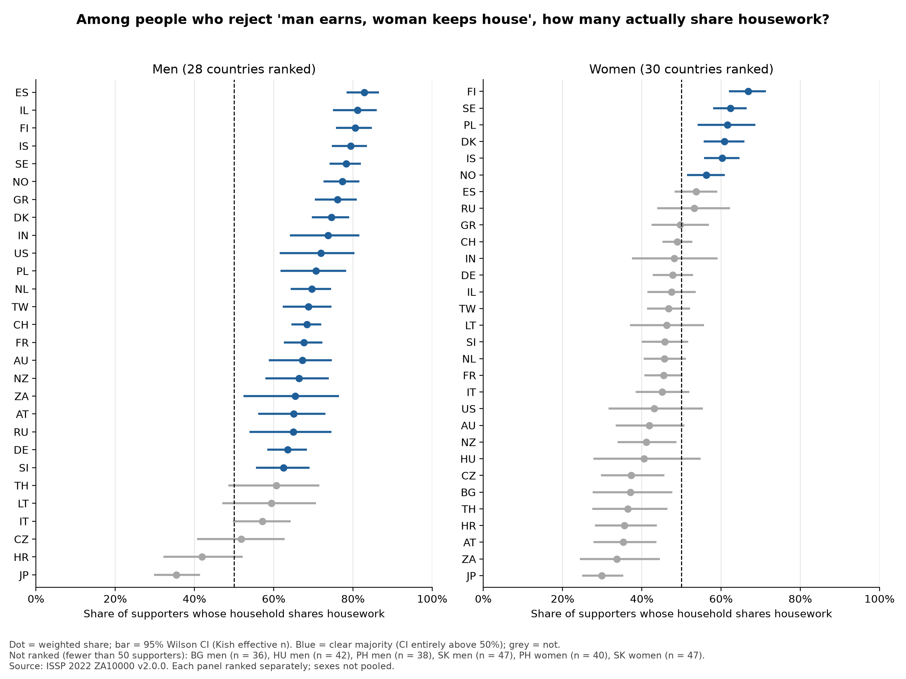
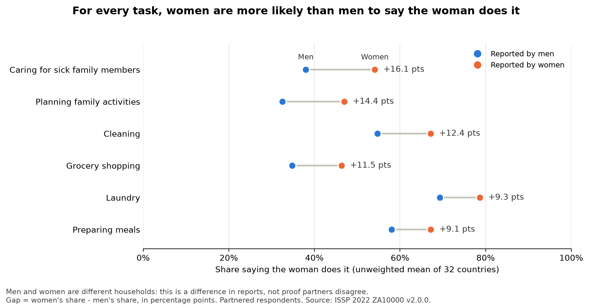

# The Harvest and the Hunt

   [](https://github.com/sairishitha-2787/The-Hunt-And-The-Harvest/actions/workflows/tests.yml)

   *Harvest the work. Hunt the gap.*

The *harvest* is the everyday work of feeding and running a home, the labour this project measures. The *hunt* is tracking down the gap between what people say and what they do.

**Question:** among people who say they support women working, how many live in households where the housework is actually shared? Measured across 32 countries with ISSP 2022 survey data, plus a local-first tool that shows one household its own split.

**Status:** 32 countries (ISSP 2022, ZA10000 v2.0.0). Analysis complete (Sessions 1-3); household tool (Session 4) not started.

## Findings

A *supporter* disagrees that "a man's job is to earn money; a woman's job is to look after the home and family". A household is *shared* if at least half the tasks the couple does are done equally or mostly by the man. Full definitions: [definitions.md](definitions.md).

1. **The say–do gap shows up in women's reports, not men's.** By men's reports, a clear majority of male supporters live in a shared household in 22 of 28 countries. By women's reports, a clear majority of female supporters do so in only 6 of 30 countries; it is a clear minority in 8 and unclear in 16 ([say_do_by_country.json](results/say_do_by_country.json)).
2. **Men and women describe the split differently, most of all for caring for the sick and for planning.** Averaged over 32 countries, women say the woman cares for sick family members more often than men do: 54% against 38%, a 16-point gap. For planning family activities, the one "invisible work" task, it is 47% against 33%, a 14-point gap. For meals and laundry the gap is 9 points ([perception_gap.json](results/perception_gap.json)).
3. **Exploratory: when the man does most of the paid work, sharing is less likely.** Supporters in couples where the man works clearly more paid hours have about half the odds of a shared household, compared with couples with roughly equal paid hours: OR 0.48 (95% CI 0.44–0.53). This was defined after an earlier result pointed to it, so it is exploratory, and it is an association, not a cause ([logit_odds_ratios_couple_hours.csv](results/logit_odds_ratios_couple_hours.csv)).
4. **Younger, degree-educated supporters without children at home share more often.** Each extra 10 years of age: OR 0.78 (0.75–0.81). A degree compared with lower secondary education or less: OR 1.44 (1.25–1.66). A child under 18 at home: OR 0.64 (0.58–0.70). These come from the pre-registered model with multiple imputation ([logit_odds_ratios.csv](results/logit_odds_ratios.csv)).
5. **India, Germany and the Netherlands look alike in raw shares but not once couples are compared like with like.**
   - Shared household, men: India 74% (64–82), Germany 64% (58–68), Netherlands 70% (64–75).
   - Shared household, women: India 48% (37–59), Germany 48% (43–53), Netherlands 46% (40–51). India's women's estimate rests on only 96 respondents, and India's fieldwork was in 2024.
   - Against the average country, holding couple's paid hours, sex, age, education and children constant: India OR 1.73 (1.27–2.36), Germany 1.02 (0.87–1.19), Netherlands 1.20 (1.01–1.41).





## Limitations

- **Different households.** Each respondent answers alone, so men's and women's answers come from different households. The gap is between their reports; it is not proof that partners disagree.
- **Hours band.** The hours-based check counts a household as shared if the woman does 40–60% of the couple's housework hours. This band was fixed before any hours-based result was computed.
- **Exploratory result.** The couple's-paid-hours result (finding 3) was not pre-registered.
- **Denmark's paid hours are mostly imputed.** 515 of 822 Danish supporters did not report their own paid hours.
- **Different-sex couples assumed.** Partner's sex is not in the data, so same-sex couples are misclassified rather than excluded.

## Data

ISSP Research Group (2025). *International Social Survey Programme: Family and Changing Gender Roles V - ISSP 2022.* GESIS Data Archive, Cologne. ZA10000 Data file Version 2.0.0, https://doi.org/10.4232/5.ZA10000.2.0.0

The data can't be redistributed. To reproduce: register at GESIS, download the Stata file (`ZA10000_v2-0-0.dta`), put it in `data/raw/`, then run:

```
python scripts/build_sample.py data/raw/ZA10000_v2-0-0.dta
```

Sample sizes per country: [results/sample_flow.csv](results/sample_flow.csv). Variable list: [variables.md](variables.md).

Definitions: [definitions.md](definitions.md).

## Run the tests

```
pip install -e ".[dev]"
pytest
```

## Prior work

- ISSP Research Group, Family and Changing Gender Roles modules (1988–2022).
- International Labour Organization (2018), *Care Work and Care Jobs for the Future of Decent Work.*
- Bursztyn et al., *How Are Gender Norms Perceived?*

Nothing here is advice about any particular household. Findings are associations, not causes.
